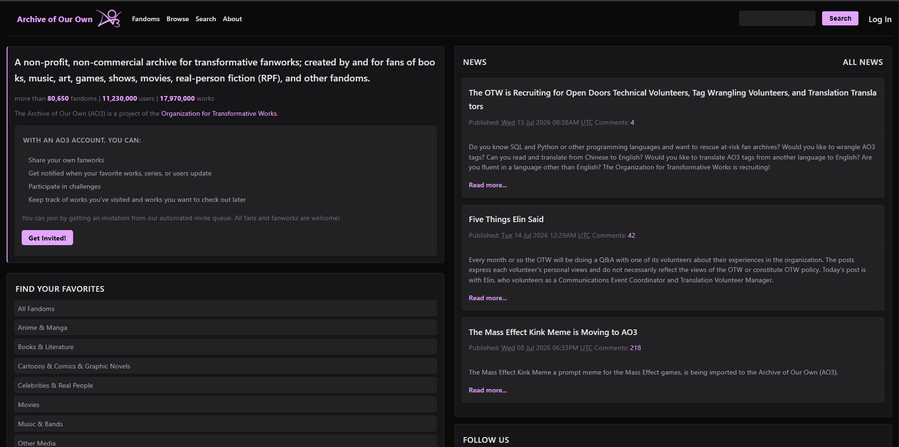
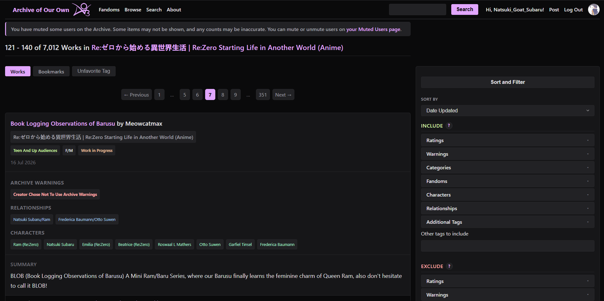
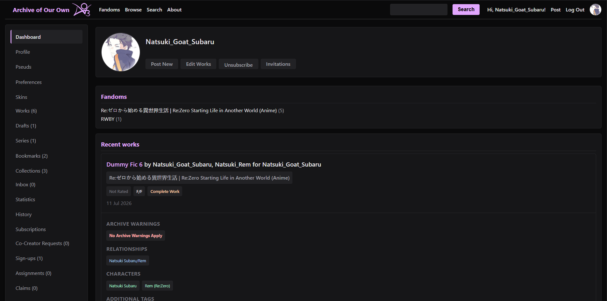
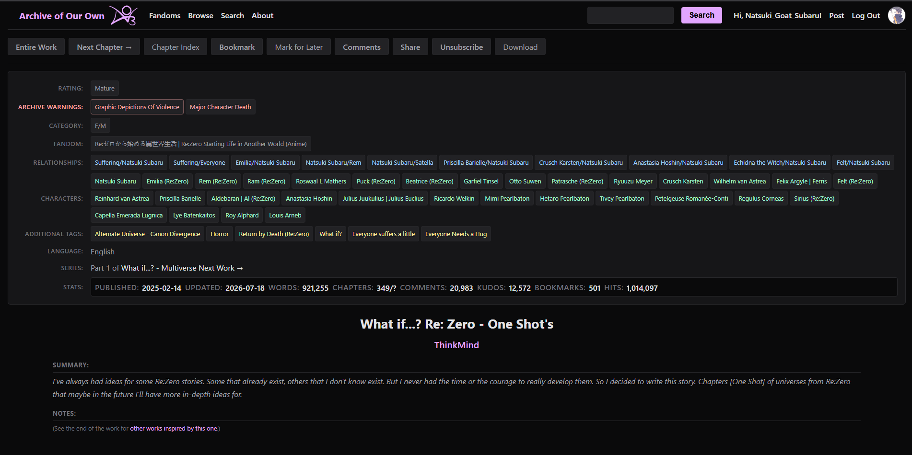
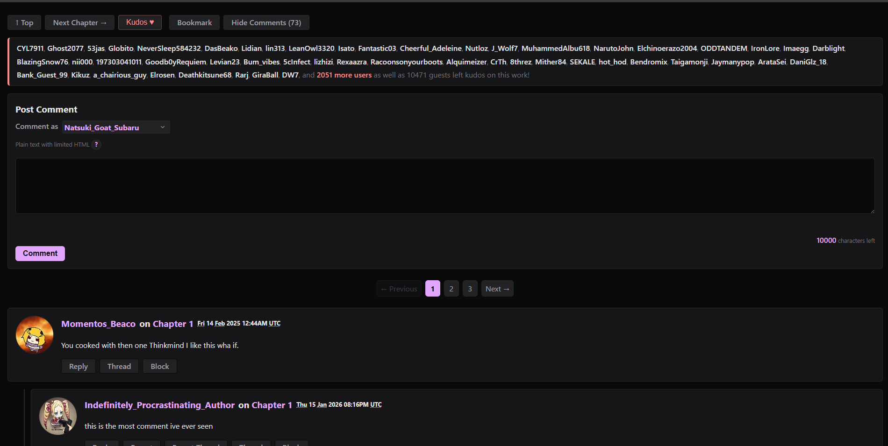
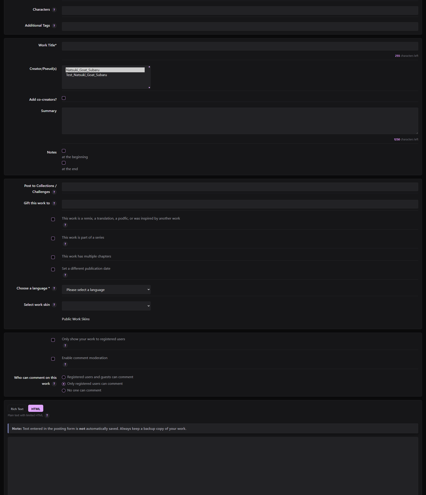

# Obsidian AO3

A dark theme for Archive of Our Own — free, ad-free, and built for comfortable reading.

**Obsidian AO3** is a Chrome extension that gives AO3 a sleek dark interface. Install it, and the theme applies instantly across the entire site. No account setup, no custom CSS required.

---

## Why This Exists

AO3's bright white backgrounds get uncomfortable after hours of reading. This extension gives you a dark, consistent look everywhere on the site.

---

## Features

- **Dark theme everywhere** — works, chapters, search, dashboard, inbox, bookmarks, and more
- **Easy on the eyes** — readable text and high contrast
- **Works without hassle** — just install and go
- **Lightweight** — pure css and js, no package bloat

---

## Installation

### Chrome Web Store

*(Coming soon – link will be added once published)*

### Firefox Add-ons

[Firefox Extension](https://addons.mozilla.org/en-US/firefox/addon/obsidian-ao3/)

### Manual Installation (Developer Mode)

1. Download or clone this repository.
2. Open Chrome and go to `chrome://extensions/`.
3. Enable **Developer mode** (toggle in the top right).
4. Click **Load unpacked** and select the extension folder.
5. The extension icon will appear in your toolbar.

---

##  Showcase

Screenshots taken from [What if...? Re: Zero - One Shot's](https://archiveofourown.org/works/63041911/chapters/161451277) (Go checkout his works)

| Homepage | Works/Fic Page |
|----------|-----------------|
|  |  |

| Dashboard | Single Fic Metadata |
|-----------|-------------------|
|  |  |

| Comments | Post/Create New |
|----------|-----------------|
|  |  |

---

## Supported Pages

Works reliably across all AO3 pages with universal route matching, including:

- Works index / browse pages
- Chapter view (focused reading mode)
- Search & filter pages
- Dashboard & profile
- Inbox & comments
- Bookmarks & collections
- Series & challenge pages
- Statistics & trends
- Gift exchanges & challenges
- Tags & wrangling guidelines

If you encounter an unstyled component or layout glitch on any page, [open an issue](https://github.com/PixelStarForge/Obsidian-Ao3/issues) with the URL and a screenshot.

---

## Troubleshooting

### The theme isn't appearing

- Reload the extension: go to `chrome://extensions`, find Obsidian AO3, and click the refresh icon
- Hard-refresh AO3 tabs: `Ctrl+Shift+R` (Windows/Linux) or `Cmd+Shift+R` (Mac)
- Check that Developer Mode is enabled

### A component looks misplaced

- Open an issue with:
  - The AO3 page URL
  - A screenshot
  - Your browser and version

### Does this work on mobile?

- The layout is responsive with mobile-friendly drawers and controls. On mobile devices, you can use the extension with Firefox for Android.

---

## Contributing

Contributions are welcome. This is an open source project, and improvements benefit everyone.

### How to contribute

1. **Fork** the repository
2. **Create a feature branch:** `git checkout -b fix/broken-layout`
3. **Make changes** (CSS, JavaScript, or both)
4. **Test thoroughly** on the affected AO3 pages
5. **Submit a pull request** with a clear description of what changed and why

### Guidelines

- **Keep it lean.** CSS-first solutions; JS only for dynamic content.
- **Respect AO3.** Don't modify functionality, redirect traffic, or inject ads.
- **Test widely.** Check your changes on multiple AO3 pages, not just one.

### Packaging & Versioning

The project includes a lightweight, zero-dependency release tool in `scripts/version.py`:

```bash
# Check current version
python3 scripts/version.py

# Set version or bump semantic increment (patch / minor / major)
python3 scripts/version.py 1.4
python3 scripts/version.py minor

# Build clean extension zip (excludes docs, pictures, README, and dev files)
python3 scripts/version.py --bundle

# Bump, commit, tag, and bundle in one command
python3 scripts/version.py 1.5 --release
```

Pushing a version tag (`git push origin v1.4`) or creating a GitHub Release automatically triggers the GitHub Actions workflow to build and attach the clean release zip.


---

##  Feedback

Found a bug? Have a suggestion? Ideas for improvements?

- **Open an issue** on GitHub with details
- **Be specific:** include the AO3 page, what you expected, what happened instead
- **Be kind:** we're all volunteers here

---

*"Enjoy reading"*


